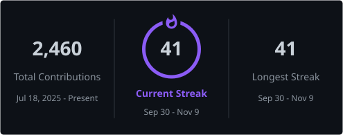

  

  
  
  
  
  

---

I'm a fullstack developer in Gothenburg with a backend focus in C# and .NET. I build APIs with clean architecture, and I run what I build myself. At home that means a bare-metal Kubernetes cluster where every change goes through Git, built to learn what happens to an application after the code is written: where it runs, how it is reached and what breaks.

### At a glance

| | |
|---|---|
| **Backend** | C#, ASP.NET Core, EF Core, Clean Architecture, CQRS, JWT, xUnit |
| **Frontend** | React, Angular, TypeScript, Tailwind CSS |
| **Homelab** | Kubernetes with kubeadm, Argo CD, Ansible, Proxmox, OPNsense, Cloudflare Tunnel, Tailscale |
| **CI/CD** | GitHub Actions, reusable pipelines, linting, schema validation and secret scanning on every change |
| **Writing** | A [blog](https://blog.meghdadjafari.dev) about backend, infrastructure and self-hosting, built from Markdown in the homelab repo |

---

### Tech

    
  

---

### GitHub stats

  
  

  

Generated daily by a GitHub Action and committed to this repository, so nothing is fetched from a third party when you load this page.

---

### Latest from the blog

<!-- BLOG-POST-LIST:START -->- [How a Change Reaches My Homelab Cluster](https://blog.meghdadjafari.dev/blog/how-a-change-reaches-my-homelab-cluster), 9 Nov 2026- [How I Deploy This Blog on My Homelab, and What Broke](https://blog.meghdadjafari.dev/blog/how-i-deploy-this-blog-on-my-homelab-and-what-broke), 28 Oct 2026- [My Homelab: Building My Own Infrastructure](https://blog.meghdadjafari.dev/blog/my-homelab-building-my-own-infrastructure), 28 Oct 2026<!-- BLOG-POST-LIST:END -->

[All posts](https://blog.meghdadjafari.dev)
